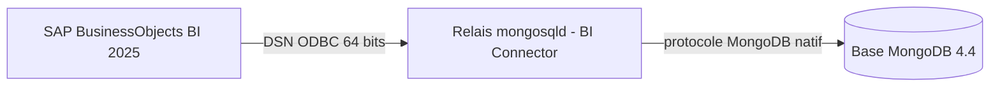

## Contexte

Un établissement d'enseignement supérieur m'a confié la migration de son infrastructure décisionnelle : il s'agissait de basculer de **SAP BusinessObjects 4.3** vers **SAP BusinessObjects BI 2025**. La plateforme alimente des rapports Web Intelligence à partir de nombreuses bases de données externes et sert un large public d'utilisateurs authentifiés via l'annuaire de l'établissement.

La mission couvrait l'installation d'une nouvelle plateforme, son paramétrage, l'optimisation de l'outil mis en production avec l'appui de l'éditeur, puis la migration des contenus depuis l'ancien serveur. Le livrable principal est une procédure d'installation et d'exploitation détaillée, pensée pour être rejouée par les équipes internes.

La mise en production a ensuite soulevé deux sujets qui sortaient du cadre d'une installation standard : **raccorder BusinessObjects à une application métier dont les données sont stockées dans MongoDB**, alors que l'outil ne consomme que des sources relationnelles via ODBC, et **corriger directement le référentiel du CMS** lorsque la console d'administration ne suffit plus, par exemple quand le compte Administrator a perdu ses droits sur une application et que celle-ci n'est plus visible.

## Ma mission

* Installer et configurer la plateforme SAP BusinessObjects BI 2025 sur plusieurs machines virtuelles (Windows Serveur) dédiées (4 structures avec plusieurs environnements).
* Dimensionner les services serveurs, en lien avec l'éditeur.
* Migrer les connexions aux sources de données et les contenus (droits, utilisateurs, univers, documents, planifications).
* Renforcer la sécurité de la plateforme et intégrer l'authentification à l'annuaire.
* Personnaliser les pages de connexion et le thème graphique aux couleurs de l'établissement.
* Raccorder la plateforme à une base MongoDB et outiller le diagnostic de la chaîne de connexion.
* Documenter la correction bas niveau du référentiel du CMS, avec ses garde-fous.
* Rédiger la documentation d'installation, d'exploitation et de retour arrière.

## Stack technique

* **SAP BusinessObjects BI Platform 2025** (Patch 12) : CMC, BI launch pad (Fiori), Web Intelligence, OpenDocument, gestion des promotions, Query Builder, Information Design Tool, SIA et CCM
* **Windows Server** sur machine virtuelle, avec Apache **Tomcat** intégré et base **SQL Anywhere** pour le référentiel et l'audit
* Pilotes **ODBC** : MySQL, MariaDB, PostgreSQL, MongoDB, Microsoft SQL Server, ainsi qu'un client **Oracle 19c**
* **MongoDB 4.4** en instance autonome, exposée à BusinessObjects par le **BI Connector 2.14** (`mongosqld`) et le **pilote ODBC MongoDB** 64 bits
* **LDAPS** pour l'authentification, certificats importés dans le magasin de confiance de la JVM SAP avec `keytool`
* **PowerShell** (5.1 et 7+), pour l'outillage, l'automatisation et les tests de connectivité

## Démarche

### Installation

J'ai retenu une installation **personnalisée** : packs de langue limités au français et à l'anglais, ajout des modèles Web Intelligence RESTful, retrait des composants inutilisés (Crystal Reports, BW Publisher) et ports dédiés pour les agents de la plateforme. Les intégrations de diagnostic de l'éditeur n'ont pas été activées.

### Préparation du serveur

* Désactivation de services automatiques pour garantir la **stabilité du service**.
* Installation des pilotes ODBC puis migration des sources de données par **export/import des clés de registre ODBC**, en ne conservant que les connexions aux bases externes et en écartant celles propres à la plateforme (audit, CMS).

### Dimensionnement

L'assistant de configuration a permis de répartir les services sur plusieurs serveurs de traitement adaptatif (profil **XL**, 11 serveurs, 40 à 60 Go de RAM). Le **dimensionnement avancé**, validé avec l'éditeur SAP sur un serveur de 64 Go, a consisté à ajuster la mémoire Java de chaque service et la création d'un serveur dédié au service de jetons de sécurité. J'ai aussi désactivé la surveillance Web Intelligence sur les services concernés et relevé les limites du moteur Web Intelligence (listes de valeurs, tris personnalisés).

Les réglages applicatifs ont complété ce travail : répertoire temporaire dédié aux archives de promotion, destinations e-mail et système de fichiers pour les planifications, indexation de la recherche, purge automatique de la corbeille et rétention des événements d'audit.

### Sécurisation

* Blocage des envois vers les stockages cloud grand public et désactivation du **SQL à la carte**.
* Sécurité de niveau supérieur sur les univers et les connexions.
* Restriction des sources de données proposées au groupe des créateurs de rapports.
* Connexion **LDAPS** à l'annuaire, avec import de l'autorité de certification racine et intermédiaire dans le magasin de certificats de la JVM.

### Migration des contenus

La gestion des promotions ne se prête pas à une procédure figée. J'ai donc défini des **bonnes pratiques** (une promotion par type d'objet, nomenclature numérotée, inclusion des paramètres de sécurité, aucun objet déjà présent en destination) et un **ordre strict** en plusieurs étapes. Le contrôle final se fait par comparaison du delta entre l'ancien et le nouveau serveur.

### Personnalisation

Les pages de connexion du BI launch pad, d'OpenDocument et de la CMC proposent désormais **LDAPS par défaut** et masquent le champ système. Le thème de l'établissement (application des chartes graphique) est appliqué au BI launch pad et à OpenDocument par la méthode éditeur de 2025 via de l'edition en CSS. Chaque opération est précédée d'une **sauvegarde** et accompagnée d'une procédure de contrôle et de retour arrière.

### Raccordement à une base MongoDB

Le point de départ était un constat simple : le pilote ODBC MongoDB parle le **protocole MySQL** et ne peut donc pas dialoguer directement avec une base MongoDB. La solution a consisté à intercaler le **BI Connector**, un relais qui se présente comme un serveur MySQL 5.7 et traduit le SQL en requêtes MongoDB.

J'ai procédé par couches, en validant chacune avant de passer à la suivante : connexion avec le compte de service via MongoSH et liste des collections, configuration de `mongosqld` (écoute locale, authentification, échantillonnage du schéma) puis installation en **service Windows** à démarrage automatique avec relance en cas d'échec, et enfin création du DSN 64 bits pointant vers le relais (localhost).

Des scripts PowerShell accompagnent la procédure. Ils permettent de tester les connexions MongoDB **sans aucun pilote installé**, vérifier la présence des DSN, ouvrir las connexions ODBC et compter les tables visibles.

La base répond correctement au test protocolaire, ce qui confirme la version de la base et accède à ses collections. La procédure prévoit une variante pour brancher plusieurs bases MongoDB sur des ports et des DSN distincts. Sur le principe, c'est un service Windows par relais.

### Correction du référentiel par le mode console du CMS

Depuis les correctifs récents de BI 2025, le **mode console du CMS** doit être explicitement autorisé par un administrateur, pour une **durée limitée** et une **liste fermée de commandes**. J'ai documenté la procédure complète en m'appuyant sur la note SAP **KBA 1828536**, illustrée sur un cas réel : la restauration du contrôle total de l'Administrator sur l'Information Design Tool.

* prérequis : **snapshot de la VM** et sauvegarde des dépôts de fichiers, avant toute intervention ;
* récupération des identifiants des objets et des rôles via des requêtes du **Query Builder** ;
* autorisation temporaire du mode console, limitée aux seules commandes nécessaires ;
* arrêt du SIA, démarrage du CMS en mode console, exécution de la commande `setrole` ;
* redémarrage du SIA et vérification dans la CMC.

C'est un cas typique d'intervention chirugical effectuée dans l'urgence, ayant pour effet de sauver une mise en production.

## Retour d'expérience

* La version 2025 change plusieurs habitudes : plus de dépendance à une installation Java séparée, disparition du conteneur d'applications web, et le fichier de surcharge du BI launch pad est désormais `FioriBI.properties`.
* L'interface de la CMC doit être basculée en anglais pour contourner des bugs d'affichage (boutons inactifs).
* Les surcharges de configuration doivent toujours être créées d'abord dans le dossier source conservé par les patchs et les redéploiements, la copie servie par Tomcat n'étant qu'une prise en compte immédiate.
* Un patch SAP écrase les archives contenant le thème. La procédure prévoit donc de réappliquer la personnalisation après chaque mise à jour.
* Le redémarrage de Tomcat après purge de son cache prend environ une heure, ce qu'il faut anticiper dans les fenêtres d'intervention.
* **Diagnostiquer couche par couche** fait gagner beaucoup de temps. Par exemple, `mysql.exe` ne permet pas de tester MongoDB : sur le port MongoDB, il reste bloqué sur l'erreur 2013, ce qui peut faire croire à tort à un problème réseau.
* Le modèle OSI redevient un standard implacable et salvateur, lorsqu'il faut communiquer avec le service qui s'occupe de réseau et éviter les tensions en interne.
* Le mode console permet d'outrepasser la CMC mais peut **corrompre le référentiel de façon irréversible**. Il est réservé aux cas sans alternative, idéalement avec le support SAP et toujours après un snapshot.
* Le BI Connector n'est qu'une **solution de transition** : son support et celui de MongoDB 4.4 arrivent à terme, et son usage au-delà du développement, du test et de l'évaluation suppose une souscription MongoDB Enterprise Advanced. J'ai donc recommandé de définir une cible durable, une interface SQL supportée ou un pilote ODBC tiers maintenu.

## Ressources

* [Documentation SAP sur l'import de certificats dans la plateforme BI](https://help.sap.com/docs/SUPPORT_CONTENT/bobjip/3519323954.html)
* [Documentation du MongoDB BI Connector](https://www.mongodb.com/docs/bi-connector/current/)
* [Référence de `mongosqld`](https://www.mongodb.com/docs/bi-connector/current/reference/mongosqld/)
* Notes SAP KBA 1828536 (mode console du CMS) et 3764463, accessibles depuis le portail SAP ONE Support.
