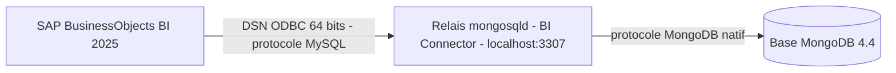

## Contexte

Ce projet prolonge la migration d'une plateforme **SAP BusinessObjects** vers la version **BI 2025**, hébergée sur des serveurs Windows et déclinée en plusieurs environnements. La mise en production a soulevé deux sujets techniques qui sortaient du cadre d'une installation standard :

* **raccorder BusinessObjects à une application métier dont les données sont stockées dans MongoDB**, alors que BO consomme des sources relationnelles via ODBC ;
* **corriger directement le référentiel du CMS** lorsque la console d'administration (CMC) ne suffit plus, par exemple quand le compte Administrator a perdu ses droits sur une application et que celle-ci n'est plus visible.

## Ma mission

J'ai traité ces deux problèmes de bout en bout : diagnostic, mise en œuvre sur les serveurs, puis rédaction de **procédures réutilisables** que l'exploitation peut appliquer sur les autres environnements de la plateforme. J'ai aussi écrit des scripts PowerShell de diagnostic pour isoler rapidement l'origine d'une panne : réseau, protocole, authentification ou pilote.

## Stack technique

* **SAP BusinessObjects BI 2025** : CMS, SIA, CCM, CMC, Query Builder, Information Design Tool
* **MongoDB 4.4** en instance autonome
* **MongoDB BI Connector 2.14** (`mongosqld`) et **pilote ODBC MongoDB** 64 bits
* **Windows Server** : services Windows, registre ODBC, Visual C++ Redistributable
* **PowerShell** (5.1 et 7+) pour les tests et l'automatisation

## Démarche

### Connecter BusinessObjects à MongoDB

Le point de départ était un constat simple : le pilote ODBC MongoDB parle le **protocole MySQL** et ne peut donc pas dialoguer directement avec une base MongoDB. La solution a consisté à intercaler le **BI Connector**, un relais qui se présente comme un serveur MySQL 5.7 et traduit le SQL en requêtes MongoDB.

J'ai procédé par couches, en validant chacune avant de passer à la suivante :

1. **Réseau** : ouverture du port MongoDB depuis le serveur BO.
2. **Protocole** : envoi d'une commande `isMaster` en protocole MongoDB natif, sans aucun pilote installé.
3. **Authentification** : connexion avec le compte de service et liste des collections.
4. **Relais** : configuration de `mongosqld` (écoute locale, authentification, échantillonnage du schéma), test en console puis installation en **service Windows** à démarrage automatique, avec relance automatique en cas d'échec.
5. **ODBC** : création du DSN 64 bits pointant vers le relais, puis test de connexion et listing des tables sans passer par l'interface graphique.

### Corriger le référentiel via le mode console du CMS

Depuis les correctifs récents de BI 2025, le **mode console du CMS** doit être explicitement autorisé par un administrateur, pour une **durée limitée** et une **liste fermée de commandes**. J'ai documenté la procédure complète en m'appuyant sur la note SAP KBA 1828536 :

* prérequis : **snapshot de la VM** et sauvegarde des dépôts de fichiers, avant toute intervention ;
* récupération des identifiants des objets et des rôles via des requêtes du **Query Builder** ;
* autorisation temporaire du mode console, limitée aux seules commandes nécessaires ;
* arrêt du SIA, démarrage du CMS en mode console, exécution de la commande `setrole` ;
* redémarrage du SIA et vérification dans la CMC.

## Réalisations

* **Procédure d'installation du relais MongoDB** : prérequis, configuration commentée, service Windows, DSN et tests, avec une variante pour brancher plusieurs bases MongoDB sur des ports et DSN distincts.
* **Script de diagnostic MongoDB sans pilote** : il ouvre une socket TCP, négocie TLS en option, construit à la main un message `OP_MSG` contenant un document BSON `isMaster`, puis décode la réponse. Chaque type d'échec (TCP, TLS, coupure) renvoie une piste de correction.
* **Script de test ODBC** : il vérifie l'architecture de PowerShell et la présence du DSN, ouvre la connexion et compte les tables visibles.
* **Procédure d'accès à la console du CMS**, illustrée sur un cas réel : la restauration du contrôle total de l'Administrator sur l'application Information Design Tool.

## Résultats

* La base répond correctement au test protocolaire (`ok = 1`, `maxWireVersion = 9`), ce qui confirme une version **MongoDB 4.4**.
* Le compte de service accède aux **114 collections** de la base.
* Le relais fonctionne comme un service Windows autonome et expose ces données à BusinessObjects via un DSN ODBC standard.
* La correction des droits par le mode console est documentée de façon reproductible, avec ses garde-fous.

## Retour d'expérience

* **Diagnostiquer couche par couche** fait gagner beaucoup de temps. Par exemple, `mysql.exe` ne permet pas de tester MongoDB : sur le port MongoDB, il reste bloqué sur l'erreur 2013, ce qui peut faire croire à tort à un problème réseau.
* Les **identifiants SI_ID varient d'un environnement à l'autre**. Seul le CUID est stable, et une procédure multi-environnements doit en tenir compte.
* Le mode console permet d'outrepasser la CMC mais peut **corrompre le référentiel de façon irréversible**. Il est réservé aux cas sans alternative, idéalement avec le support SAP et toujours après un snapshot.
* Le BI Connector est une **solution de transition**. Sans souscription Enterprise Advanced, il est limité au développement, au test et à l'évaluation, et son support comme celui de MongoDB 4.4 arrive à terme. J'ai donc recommandé de définir une cible durable : une interface SQL supportée ou un pilote ODBC tiers maintenu.
